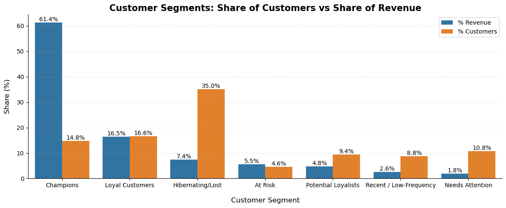
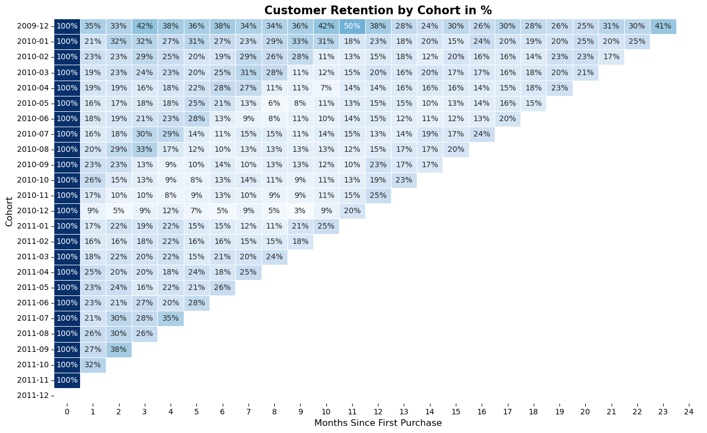
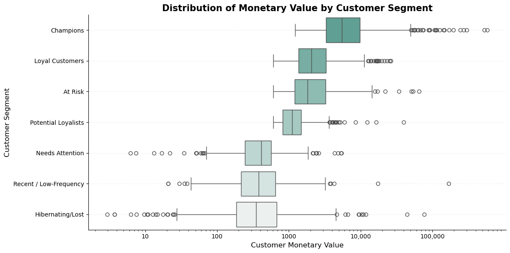

# Customer Segmentation & Retention Analysis — Online Retail II

Analiza zachowania klientów sklepu internetowego na podstawie danych transakcyjnych z lat 2009–2011, łącząca segmentację RFM z analizą kohortową retencji.

## Cel projektu

Celem projektu jest odpowiedź na dwa powiązane pytania biznesowe:
- **Kim są najbardziej wartościowi klienci sklepu i jak duży wpływ mają na przychód?** (segmentacja RFM)
- **Jak zmienia się skłonność klientów do powrotu w zależności od momentu ich pozyskania?** (analiza kohortowa)

Projekt obejmuje pełny proces: czyszczenie danych, eksploracyjną analizę danych (EDA), budowę tabeli RFM, segmentację klientów, analizę retencji kohort oraz analizę czasu do drugiego zakupu — wraz z udokumentowanymi decyzjami metodologicznymi i ograniczeniami zastosowanych metod.

## Dane

Projekt wykorzystuje zbiór [Online Retail II](https://archive.ics.uci.edu/dataset/502/online+retail+ii) z UCI Machine Learning Repository — dane transakcyjne brytyjskiego sklepu internetowego z artykułami prezentowymi (giftware) z okresu grudzień 2009 – grudzień 2011.

Plik danych (`online_retail_II.xlsx`) nie jest dołączony do repozytorium ze względu na rozmiar — należy pobrać go samodzielnie ze strony UCI i umieścić w katalogu głównym projektu przed uruchomieniem notebooka.

## Metodologia

**1. Czyszczenie danych** — połączenie dwóch arkuszy, usunięcie duplikatów, analiza i usunięcie transakcji anulowanych, korekt księgowych, kodów technicznych (opłaty, próbki, karty podarunkowe) oraz rekordów bez Customer ID. Każda decyzja o usunięciu poprzedzona sprawdzeniem charakterystyki danego wycinka danych.

**2. Analiza RFM** — obliczenie Recency, Frequency, Monetary dla każdego klienta (+ opis rozkładów), punktacja metodą kwintyli (`pd.qcut`), a następnie segmentacja na 7 grup klientów na podstawie iteracyjnej analizy, wykorzystując również tabele krzyżowe.

**3. Analiza kohortowa** — przypisanie klientów do kohort wg miesiąca pierwszego zakupu, budowa tabeli retencji, analiza retencji M1 z testem statystycznym istotności różnicy między latami (`statsmodels.stats.proportion`), oraz analiza czasu do drugiego zakupu.

## Kluczowe wnioski

- Segmenty **Champions** i **Loyal Customers** stanowią łącznie 31,4% bazy klientów, ale odpowiadają za **77,9% wartości sprzedaży** — silna koncentracja wartości w niewielkiej części bazy.
- Segment **At Risk** (4,6% klientów) wykazuje historyczną wartość zbliżoną do Loyal Customers, ale medianowy czas od ostatniego zakupu wynosi 323 dni — grupa o wysokim potencjale do selektywnej reaktywacji.
- Liczba nowo pozyskanych klientów spadła w 2011 roku o ok. 54% względem 2010, mimo że retencja M1 w porównywalnych kohortach wzrosła (różnica istotna statystycznie, p = 0,022) — spadku akwizycji nie można wyjaśnić pogorszeniem jakości pozyskiwanych klientów.
- Retencja klientów po pierwszym zakupie jest zróżnicowana sezonowo — kohorty pozyskane w drugiej połowie roku (okres przedświąteczny) wykazują wyższą retencję.

Szczegółowe wnioski w notebooku, w dedykowanych sekcjach.

## Wybrane wizualizacje 









## Ograniczenia

- Segmentacja RFM nie uwzględnia momentu pozyskania klienta (tenure) — segment *Recent / Low-Frequency* może częściowo zawierać dawno pozyskanych, uśpionych klientów, a nie wyłącznie nowych. Szczegóły i dowód (tabela krzyżowa kohort × segmenty) w notebooku.
- Kohorta grudnia 2009 (pierwszy miesiąc danych) i grudnia 2011 (niepełny miesiąc) nie są w pełni porównywalne z pozostałymi kohortami.
- Nowsze kohorty mają krótsze okno obserwacji, co ogranicza porównania w dłuższym horyzoncie czasowym.

Pełny opis ograniczeń wraz z uzasadnieniem — w notebooku, w dedykowanych sekcjach.

## Struktura repozytorium

```
├── Projekt_Retencja.ipynb    # główny notebook z pełną analizą
├── README.md
```
## Author

**Adam Płonkiewicz** – [LinkedIn](https://www.linkedin.com/in/adam-p%C5%82onkiewicz-762ab124a/)
## Technologie

Python, pandas, numpy, matplotlib, seaborn, statsmodels, scipy, re

